# HeadCanon canon index

Generated by `headcanon render`. Do not edit; edit the nodes and rerun. Colors: green stated, blue resolved, amber assumed, violet open, red contested.

## Top levels

```mermaid
flowchart LR
    REQ_1["REQ-1<br/>Divergence from intent is caught early, where t…"]:::stated
    REQ_1_1["REQ-1.1<br/>Three target failure modes: substitution, justi…"]:::stated
    REQ_1_2["REQ-1.2<br/>Root cause stays an open hypothesis; the design…"]:::stated
    REQ_1_3["REQ-1.3<br/>Tag each caught divergence with its origin, as …"]:::stated
    REQ_2["REQ-2<br/>Two products share one intent format"]:::stated
    REQ_2_1["REQ-2.1<br/>Two products: HeadCanon (agent alignment during…"]:::stated
    REQ_2_2["REQ-2.2<br/>HeadCanon is the priority now"]:::stated
    REQ_2_3["REQ-2.3<br/>Writ builds on teams' existing test tooling ins…"]:::stated
    REQ_2_4["REQ-2.4<br/>HeadCanon is a Claude Code plugin first; both p…"]:::stated
    REQ_2_5["REQ-2.5<br/>The user supplies Writ's model; v1 supports Ant…"]:::stated
    REQ_2_6["REQ-2.6<br/>The shared canon CLI never calls a model"]:::resolved
    REQ_2_7["REQ-2.7<br/>Two repositories: headcanon and writ"]:::stated
    REQ_2_8["REQ-2.8<br/>Windows plus macOS are supported first; Linux f…"]:::resolved
    REQ_2_9["REQ-2.9<br/>Writ's v1 test environment is Node"]:::stated
    REQ_3["REQ-3<br/>Intent is a tree of requirements refined to bin…"]:::stated
    REQ_3_1["REQ-3.1<br/>HeadCanon's own model is the description framew…"]:::stated
    REQ_3_2["REQ-3.2<br/>KAOS obstacle analysis is kept in mind, not ado…"]:::stated
    REQ_3_3["REQ-3.3<br/>Requirements form a tree, refined down to binar…"]:::stated
    REQ_3_4["REQ-3.4<br/>The tree is filled lazily: gaps surface when re…"]:::stated
    REQ_3_5["REQ-3.5<br/>Human-judgment leaves are allowed (e.g. aesthet…"]:::stated
    REQ_3_6["REQ-3.6<br/>Binary leaves are proxies; passing leaves do no…"]:::assumed
    REQ_3_7["REQ-3.7<br/>Principles are kept apart from requirements; ev…"]:::stated
    REQ_4["REQ-4<br/>User journeys are first-class intent records"]:::stated
    REQ_4_1["REQ-4.1<br/>User journeys are intent records, not tests, ke…"]:::stated
    REQ_4_2["REQ-4.2<br/>Journeys are decision graphs whose steps link m…"]:::stated
    REQ_4_3["REQ-4.3<br/>Journey files: a Mermaid flowchart plus a step-…"]:::assumed
    REQ_5["REQ-5<br/>Terms and certainty are modeled, never hidden"]:::stated
    REQ_5_1["REQ-5.1<br/>The root canon file's Glossary section defines …"]:::stated
    REQ_5_2["REQ-5.2<br/>Undefined or badly defined elements are modeled…"]:::stated
    REQ_5_3["REQ-5.3<br/>Five certainty states: stated, assumed, open, c…"]:::stated
    REQ_5_4["REQ-5.4<br/>The agent never fills a gap silently"]:::assumed
    REQ_6["REQ-6<br/>The canon is plain files that existing tools al…"]:::stated
    REQ_6_1["REQ-6.1<br/>Canon stored as Markdown with front-matter, in …"]:::stated
    REQ_6_2["REQ-6.2<br/>Generated views: a text tree inside the agent, …"]:::stated
    REQ_6_3["REQ-6.3<br/>Folder layout: root README, one folder per bran…"]:::assumed
    REQ_6_4["REQ-6.4<br/>Node file front-matter fields"]:::assumed
    REQ_6_5["REQ-6.5<br/>Mermaid index limits and generated-view freshne…"]:::assumed
    REQ_6_6["REQ-6.6<br/>ID scheme for requirements, journeys, steps, de…"]:::resolved
    REQ_7["REQ-7<br/>Success criteria exist before code, and obstacl…"]:::stated
    REQ_7_1["REQ-7.1<br/>Workflow runs requirements → tests → implementa…"]:::stated
    REQ_7_2["REQ-7.2<br/>Negotiation is a triggered mode, not an upfront…"]:::stated
    REQ_7_3["REQ-7.3<br/>The agent may work around obstacles alone if in…"]:::stated
    REQ_7_4["REQ-7.4<br/>#quot;Preserved#quot; means every affected journey still …"]:::stated
    REQ_7_5["REQ-7.5<br/>Stopping to raise an obstacle counts as a succe…"]:::assumed
    REQ_8["REQ-8<br/>Intent never changes silently"]:::stated
    REQ_8_1["REQ-8.1<br/>Intent history is append-only; the agent propos…"]:::stated
    REQ_8_2["REQ-8.2<br/>Decision records link to intents and get flagge…"]:::stated
    REQ_8_3["REQ-8.3<br/>Intent descriptions go in commit messages in a …"]:::stated
    REQ_8_4["REQ-8.4<br/>Canon files hold the current intent; commit tra…"]:::stated
    REQ_8_5["REQ-8.5<br/>Commit format: Conventional Commits header plus…"]:::assumed
    REQ_8_6["REQ-8.6<br/>The agent changes the canon only through create…"]:::stated
    REQ_8_7["REQ-8.7<br/>CUD covers all canon objects; updates are patch…"]:::assumed
    REQ_9["REQ-9<br/>Writ verifies every change against the canon"]:::stated
    REQ_9_1["REQ-9.1<br/>Intent-traced verification is Writ's headline o…"]:::stated
    REQ_9_2["REQ-9.2<br/>Writ checks intent before code; intent takes pr…"]:::stated
    REQ_9_3["REQ-9.3<br/>Preservation reruns every earlier approved test…"]:::stated
    REQ_9_4["REQ-9.4<br/>HeadCanon can request acceptance tests from Wri…"]:::stated
    REQ_9_5["REQ-9.5<br/>Writ stores acceptance tests so they aren't reg…"]:::stated
    REQ_9_6["REQ-9.6<br/>Acceptance tests are locked: the agent can run …"]:::assumed
    REQ_9_7["REQ-9.7<br/>A hash of the intent package pins its tests; a …"]:::assumed
    REQ_9_8["REQ-9.8<br/>Writ holds reusable test datasets with ground t…"]:::stated
    REQ_9_9["REQ-9.9<br/>Small datasets are committed to the repo as fix…"]:::stated
    REQ_9_10["REQ-9.10<br/>Separate verifier role; mutation testing"]:::assumed
    REQ_9_11["REQ-9.11<br/>Weakening a test needs an intent change and hum…"]:::stated
    REQ_9_12["REQ-9.12<br/>Baselines for numeric and open-ended requiremen…"]:::stated
    REQ_9_13["REQ-9.13<br/>HeadCanon also measures in the session; Writ is…"]:::stated
    REQ_9_14["REQ-9.14<br/>Binary baselines, tolerance in the canon, drift…"]:::stated
    REQ_9_15["REQ-9.15<br/>The model proposes tolerances and the human app…"]:::stated
    REQ_9_16["REQ-9.16<br/>Model checks are non-deterministic; Writ's revi…"]:::stated
    REQ_9_17["REQ-9.17<br/>Which CI run's numbers count for baselines"]:::open
    REQ_10["REQ-10<br/>Writ sits a layer above the team's tools and ru…"]:::stated
    REQ_10_1["REQ-10.1<br/>Writ runs in CI, outside the agent's session"]:::stated
    REQ_10_2["REQ-10.2<br/>A Writ GitHub Action installs the CLI, runs the…"]:::stated
    REQ_10_3["REQ-10.3<br/>Writ is one CLI (local, CI step, required PR ch…"]:::assumed
    REQ_10_4["REQ-10.4<br/>Writ reduces redundancy, fits existing ecosyste…"]:::stated
    REQ_10_5["REQ-10.5<br/>Requirements link to files or functions; Writ s…"]:::stated
    REQ_10_6["REQ-10.6<br/>Links are many-to-many; unlinked changes are fl…"]:::assumed
    REQ_11["REQ-11<br/>HeadCanon keeps the agent aligned from inside C…"]:::stated
    REQ_11_1["REQ-11.1<br/>SessionStart summary instead of editing CLAUDE.…"]:::assumed
    REQ_11_2["REQ-11.2<br/>What lives where inside the plugin"]:::assumed
    REQ_11_3["REQ-11.3<br/>All hooks live at plugin level"]:::assumed
    REQ_11_4["REQ-11.4<br/>The E2E target is discovered by developing Head…"]:::stated
    REQ_11_5["REQ-11.5<br/>HeadCanon is built with itself from the first c…"]:::resolved
    REQ_11_6["REQ-11.6<br/>Adopting HeadCanon in an existing project is to…"]:::stated
    REQ_12["REQ-12<br/>Viewing surfaces and the paid team layer come a…"]:::assumed
    REQ_12_1["REQ-12.1<br/>A local viewer now; an MCP App later"]:::stated
    REQ_12_2["REQ-12.2<br/>Paid product: a hosted team layer over the open…"]:::assumed
    REQ_12_3["REQ-12.3<br/>No hosted coding environment; no Claude.ai logi…"]:::assumed
    REQ_13["REQ-13<br/>Open parts stay genuinely open; revenue comes f…"]:::assumed
    REQ_13_1["REQ-13.1<br/>Apache 2.0 for the canon spec, HeadCanon and Wr…"]:::resolved
    REQ_13_2["REQ-13.2<br/>The hosted team layer stays proprietary"]:::assumed
    REQ_13_3["REQ-13.3<br/>Register the HeadCanon trademark; check Writ's …"]:::assumed
    REQ_13_4["REQ-13.4<br/>A Harmony-based CLA, signed via CLA Assistant, …"]:::assumed
    REQ_13_5["REQ-13.5<br/>Clean-room provenance: everything written from …"]:::assumed
    REQ_1 --> REQ_1_1
    REQ_1 --> REQ_1_2
    REQ_1 --> REQ_1_3
    REQ_2 --> REQ_2_1
    REQ_2 --> REQ_2_2
    REQ_2 --> REQ_2_3
    REQ_2 --> REQ_2_4
    REQ_2 --> REQ_2_5
    REQ_2 --> REQ_2_6
    REQ_2 --> REQ_2_7
    REQ_2 --> REQ_2_8
    REQ_2 --> REQ_2_9
    REQ_3 --> REQ_3_1
    REQ_3 --> REQ_3_2
    REQ_3 --> REQ_3_3
    REQ_3 --> REQ_3_4
    REQ_3 --> REQ_3_5
    REQ_3 --> REQ_3_6
    REQ_3 --> REQ_3_7
    REQ_4 --> REQ_4_1
    REQ_4 --> REQ_4_2
    REQ_4 --> REQ_4_3
    REQ_5 --> REQ_5_1
    REQ_5 --> REQ_5_2
    REQ_5 --> REQ_5_3
    REQ_5 --> REQ_5_4
    REQ_6 --> REQ_6_1
    REQ_6 --> REQ_6_2
    REQ_6 --> REQ_6_3
    REQ_6 --> REQ_6_4
    REQ_6 --> REQ_6_5
    REQ_6 --> REQ_6_6
    REQ_7 --> REQ_7_1
    REQ_7 --> REQ_7_2
    REQ_7 --> REQ_7_3
    REQ_7 --> REQ_7_4
    REQ_7 --> REQ_7_5
    REQ_8 --> REQ_8_1
    REQ_8 --> REQ_8_2
    REQ_8 --> REQ_8_3
    REQ_8 --> REQ_8_4
    REQ_8 --> REQ_8_5
    REQ_8 --> REQ_8_6
    REQ_8 --> REQ_8_7
    REQ_9 --> REQ_9_1
    REQ_9 --> REQ_9_2
    REQ_9 --> REQ_9_3
    REQ_9 --> REQ_9_4
    REQ_9 --> REQ_9_5
    REQ_9 --> REQ_9_6
    REQ_9 --> REQ_9_7
    REQ_9 --> REQ_9_8
    REQ_9 --> REQ_9_9
    REQ_9 --> REQ_9_10
    REQ_9 --> REQ_9_11
    REQ_9 --> REQ_9_12
    REQ_9 --> REQ_9_13
    REQ_9 --> REQ_9_14
    REQ_9 --> REQ_9_15
    REQ_9 --> REQ_9_16
    REQ_9 --> REQ_9_17
    REQ_10 --> REQ_10_1
    REQ_10 --> REQ_10_2
    REQ_10 --> REQ_10_3
    REQ_10 --> REQ_10_4
    REQ_10 --> REQ_10_5
    REQ_10 --> REQ_10_6
    REQ_11 --> REQ_11_1
    REQ_11 --> REQ_11_2
    REQ_11 --> REQ_11_3
    REQ_11 --> REQ_11_4
    REQ_11 --> REQ_11_5
    REQ_11 --> REQ_11_6
    REQ_12 --> REQ_12_1
    REQ_12 --> REQ_12_2
    REQ_12 --> REQ_12_3
    REQ_13 --> REQ_13_1
    REQ_13 --> REQ_13_2
    REQ_13 --> REQ_13_3
    REQ_13 --> REQ_13_4
    REQ_13 --> REQ_13_5
    classDef stated fill:#e3f5ea,stroke:#1f8a4c,color:#1a1d23
    classDef resolved fill:#e8efff,stroke:#2563eb,color:#1a1d23
    classDef assumed fill:#fff3d6,stroke:#b7791f,color:#1a1d23
    classDef open fill:#ece9fb,stroke:#6b5bd2,color:#1a1d23
    classDef contested fill:#fde7e8,stroke:#d13438,color:#1a1d23
```

## REQ-1 Divergence from intent is caught early, where the human sees it

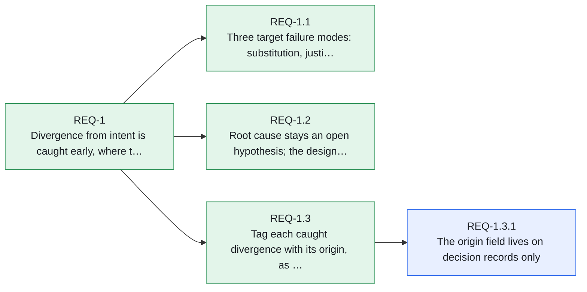

## REQ-2 Two products share one intent format

```mermaid
flowchart LR
    REQ_2["REQ-2<br/>Two products share one intent format"]:::stated
    REQ_2_1["REQ-2.1<br/>Two products: HeadCanon (agent alignment during…"]:::stated
    REQ_2_2["REQ-2.2<br/>HeadCanon is the priority now"]:::stated
    REQ_2_3["REQ-2.3<br/>Writ builds on teams' existing test tooling ins…"]:::stated
    REQ_2_4["REQ-2.4<br/>HeadCanon is a Claude Code plugin first; both p…"]:::stated
    REQ_2_5["REQ-2.5<br/>The user supplies Writ's model; v1 supports Ant…"]:::stated
    REQ_2_6["REQ-2.6<br/>The shared canon CLI never calls a model"]:::resolved
    REQ_2_6_1["REQ-2.6.1<br/>What the check command counts as a problem"]:::assumed
    REQ_2_7["REQ-2.7<br/>Two repositories: headcanon and writ"]:::stated
    REQ_2_8["REQ-2.8<br/>Windows plus macOS are supported first; Linux f…"]:::resolved
    REQ_2_9["REQ-2.9<br/>Writ's v1 test environment is Node"]:::stated
    REQ_2 --> REQ_2_1
    REQ_2 --> REQ_2_2
    REQ_2 --> REQ_2_3
    REQ_2 --> REQ_2_4
    REQ_2 --> REQ_2_5
    REQ_2 --> REQ_2_6
    REQ_2_6 --> REQ_2_6_1
    REQ_2 --> REQ_2_7
    REQ_2 --> REQ_2_8
    REQ_2 --> REQ_2_9
    classDef stated fill:#e3f5ea,stroke:#1f8a4c,color:#1a1d23
    classDef resolved fill:#e8efff,stroke:#2563eb,color:#1a1d23
    classDef assumed fill:#fff3d6,stroke:#b7791f,color:#1a1d23
    classDef open fill:#ece9fb,stroke:#6b5bd2,color:#1a1d23
    classDef contested fill:#fde7e8,stroke:#d13438,color:#1a1d23
```

## REQ-3 Intent is a tree of requirements refined to binary leaves

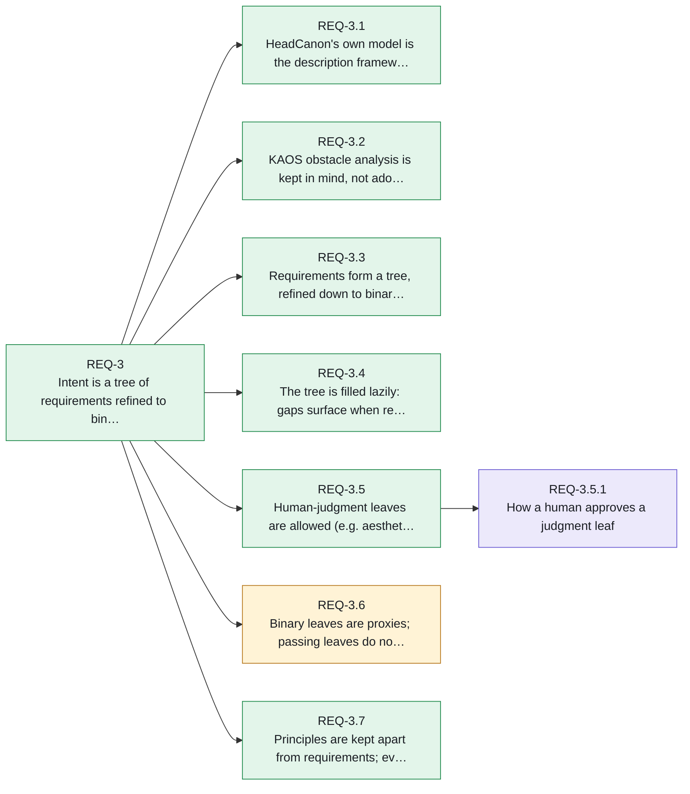

## REQ-4 User journeys are first-class intent records

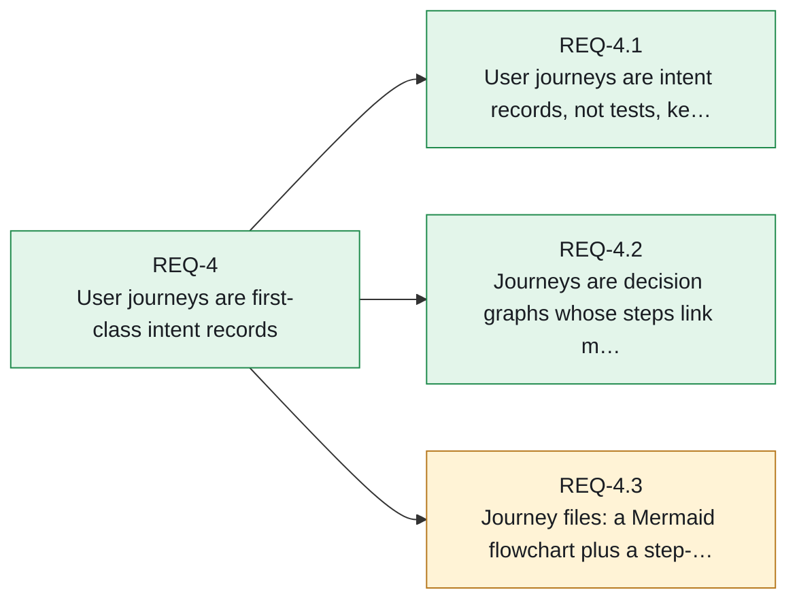

## REQ-5 Terms and certainty are modeled, never hidden

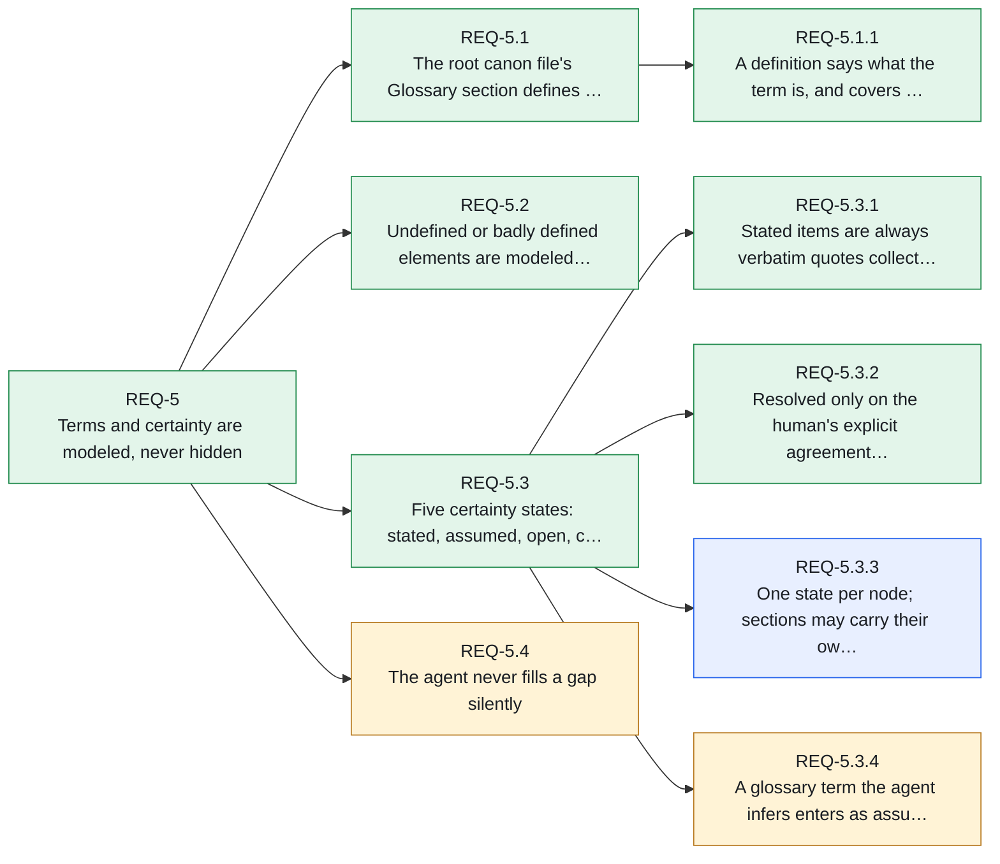

## REQ-6 The canon is plain files that existing tools already render

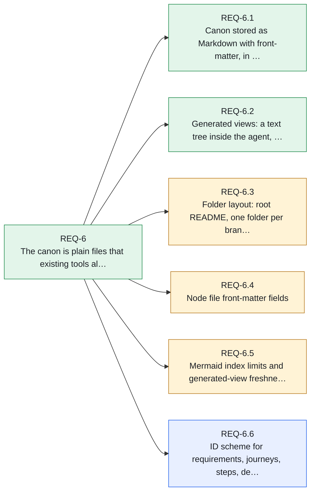

## REQ-7 Success criteria exist before code, and obstacles are negotiated, not absorbed

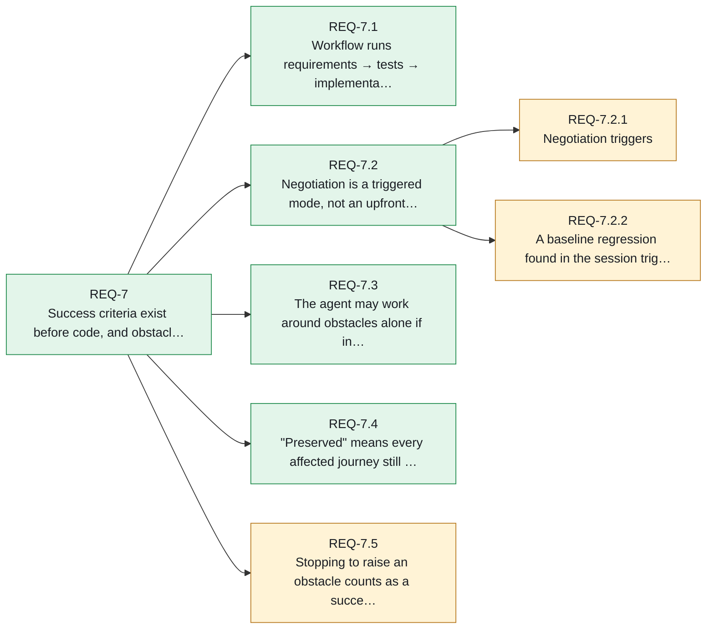

## REQ-8 Intent never changes silently

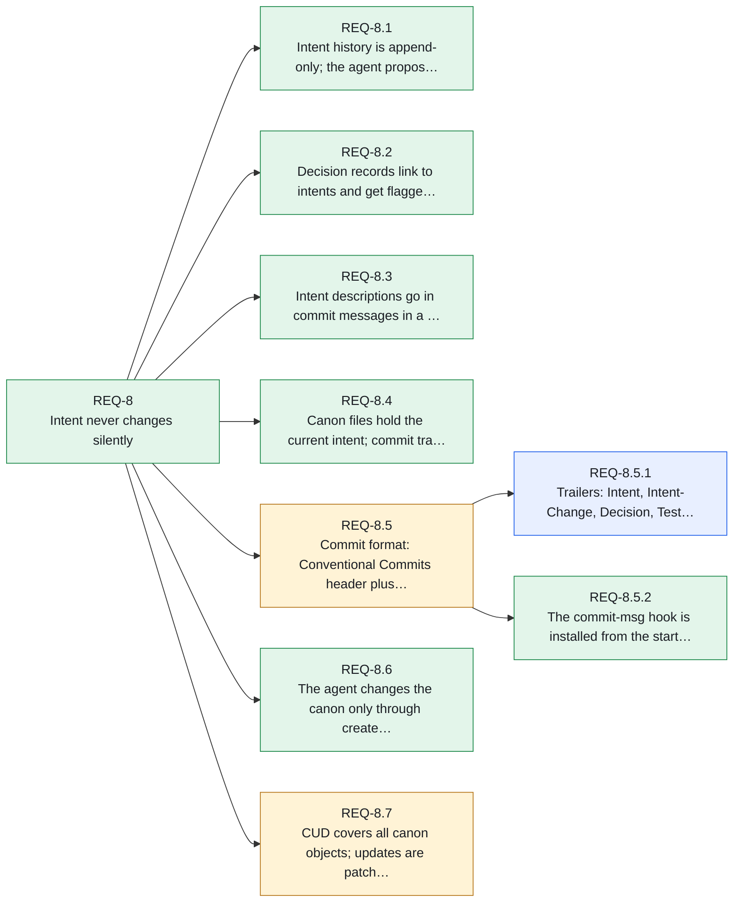

## REQ-9 Writ verifies every change against the canon

```mermaid
flowchart LR
    REQ_9["REQ-9<br/>Writ verifies every change against the canon"]:::stated
    REQ_9_1["REQ-9.1<br/>Intent-traced verification is Writ's headline o…"]:::stated
    REQ_9_2["REQ-9.2<br/>Writ checks intent before code; intent takes pr…"]:::stated
    REQ_9_3["REQ-9.3<br/>Preservation reruns every earlier approved test…"]:::stated
    REQ_9_4["REQ-9.4<br/>HeadCanon can request acceptance tests from Wri…"]:::stated
    REQ_9_5["REQ-9.5<br/>Writ stores acceptance tests so they aren't reg…"]:::stated
    REQ_9_6["REQ-9.6<br/>Acceptance tests are locked: the agent can run …"]:::assumed
    REQ_9_7["REQ-9.7<br/>A hash of the intent package pins its tests; a …"]:::assumed
    REQ_9_8["REQ-9.8<br/>Writ holds reusable test datasets with ground t…"]:::stated
    REQ_9_9["REQ-9.9<br/>Small datasets are committed to the repo as fix…"]:::stated
    REQ_9_10["REQ-9.10<br/>Separate verifier role; mutation testing"]:::assumed
    REQ_9_11["REQ-9.11<br/>Weakening a test needs an intent change and hum…"]:::stated
    REQ_9_12["REQ-9.12<br/>Baselines for numeric and open-ended requiremen…"]:::stated
    REQ_9_13["REQ-9.13<br/>HeadCanon also measures in the session; Writ is…"]:::stated
    REQ_9_14["REQ-9.14<br/>Binary baselines, tolerance in the canon, drift…"]:::stated
    REQ_9_15["REQ-9.15<br/>The model proposes tolerances and the human app…"]:::stated
    REQ_9_16["REQ-9.16<br/>Model checks are non-deterministic; Writ's revi…"]:::stated
    REQ_9_17["REQ-9.17<br/>Which CI run's numbers count for baselines"]:::open
    REQ_9 --> REQ_9_1
    REQ_9 --> REQ_9_2
    REQ_9 --> REQ_9_3
    REQ_9 --> REQ_9_4
    REQ_9 --> REQ_9_5
    REQ_9 --> REQ_9_6
    REQ_9 --> REQ_9_7
    REQ_9 --> REQ_9_8
    REQ_9 --> REQ_9_9
    REQ_9 --> REQ_9_10
    REQ_9 --> REQ_9_11
    REQ_9 --> REQ_9_12
    REQ_9 --> REQ_9_13
    REQ_9 --> REQ_9_14
    REQ_9 --> REQ_9_15
    REQ_9 --> REQ_9_16
    REQ_9 --> REQ_9_17
    classDef stated fill:#e3f5ea,stroke:#1f8a4c,color:#1a1d23
    classDef resolved fill:#e8efff,stroke:#2563eb,color:#1a1d23
    classDef assumed fill:#fff3d6,stroke:#b7791f,color:#1a1d23
    classDef open fill:#ece9fb,stroke:#6b5bd2,color:#1a1d23
    classDef contested fill:#fde7e8,stroke:#d13438,color:#1a1d23
```

## REQ-10 Writ sits a layer above the team's tools and runs where they run

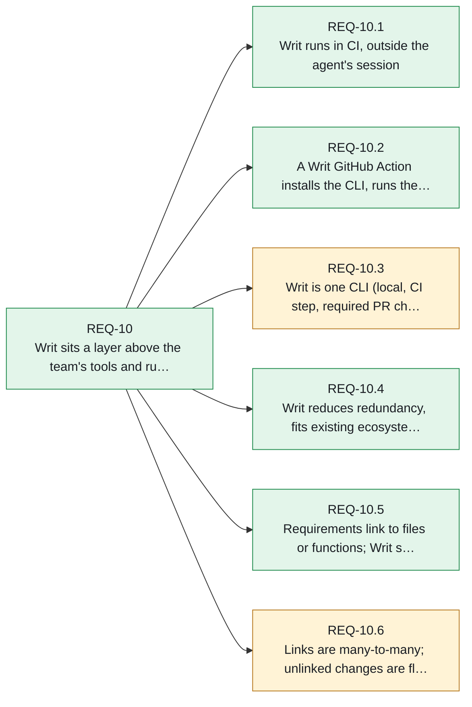

## REQ-11 HeadCanon keeps the agent aligned from inside Claude Code

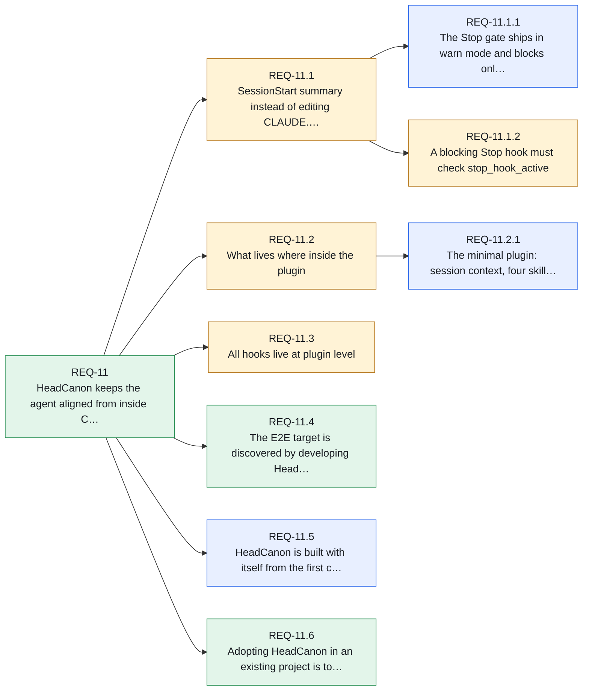

## REQ-12 Viewing surfaces and the paid team layer come after v1

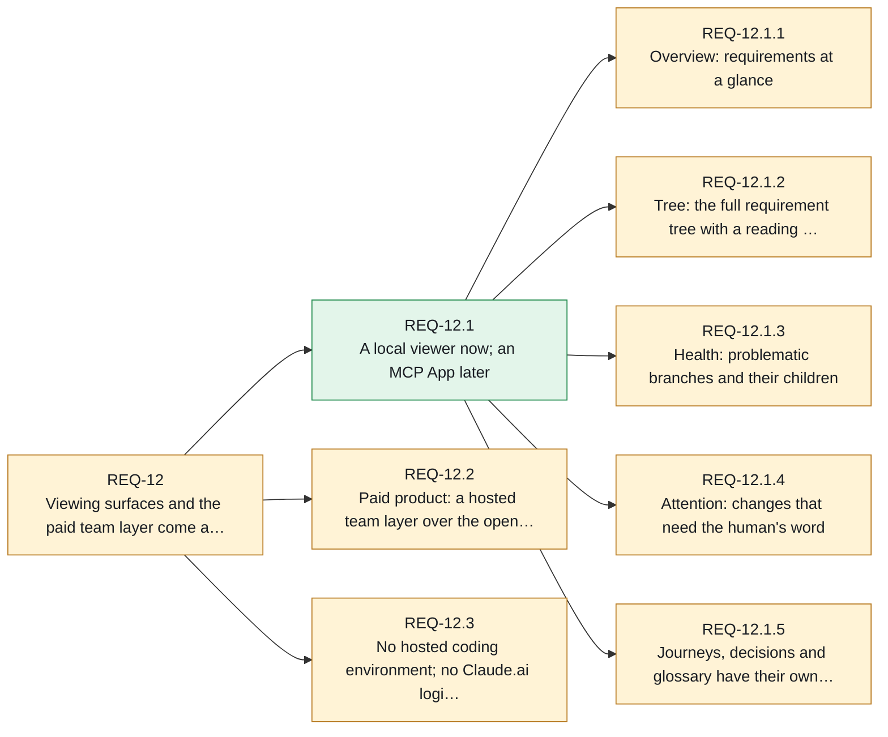

## REQ-13 Open parts stay genuinely open; revenue comes from the hosted layer

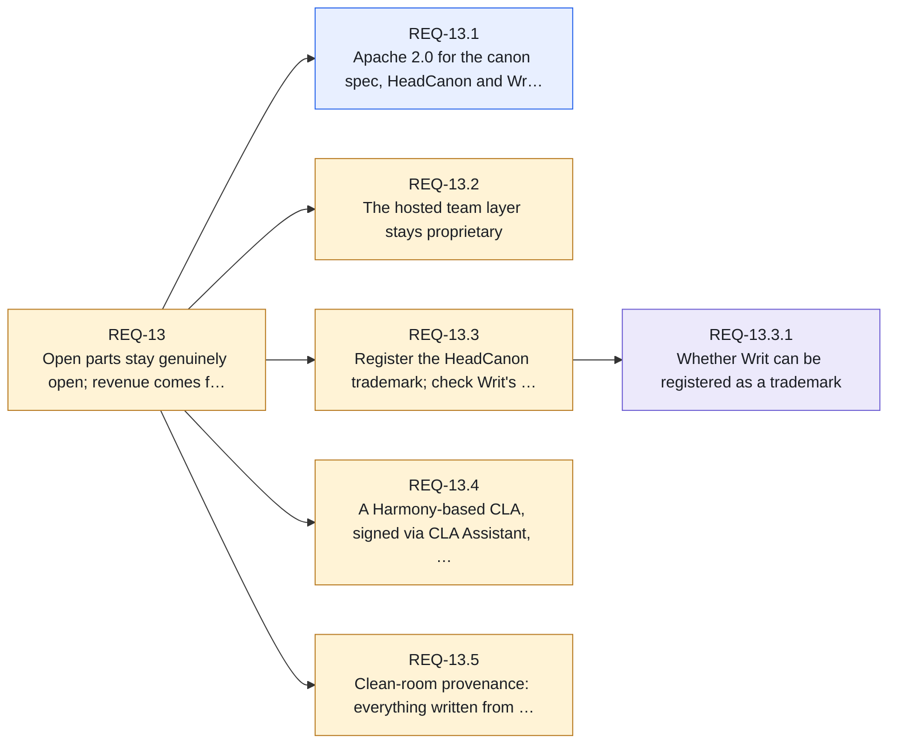

## Journeys

- **JRN-1** A working session with HeadCanon (assumed, 15 steps)
- **JRN-2** Acceptance tests written ahead of implementation (assumed, 9 steps)
- **JRN-3** Writ gates a pull request (assumed, 11 steps)

## Text tree

```
REQ-1             Divergence from intent is caught early, where the human sees it           stated    · unrefined
├─ REQ-1.1        Three target failure modes: substitution, justification, erosion          stated    · unrefined
├─ REQ-1.2        Root cause stays an open hypothesis; the design must work under both      stated    · unrefined
└─ REQ-1.3        Tag each caught divergence with its origin, as an opt-out field; trial …  stated    · unrefined
   └─ REQ-1.3.1   The origin field lives on decision records only                           resolved  · unrefined
REQ-2             Two products share one intent format                                      stated    · unrefined
├─ REQ-2.1        Two products: HeadCanon (agent alignment during implementation) and Wri…  stated    · unrefined
├─ REQ-2.2        HeadCanon is the priority now                                             stated    · unrefined
├─ REQ-2.3        Writ builds on teams' existing test tooling instead of replacing it       stated    · unrefined
├─ REQ-2.4        HeadCanon is a Claude Code plugin first; both products model-agnostic i…  stated    · unrefined
├─ REQ-2.5        The user supplies Writ's model; v1 supports Anthropic models and API ke…  stated    · unrefined
├─ REQ-2.6        The shared canon CLI never calls a model                                  resolved  · unrefined
│  └─ REQ-2.6.1   What the check command counts as a problem                                assumed   · unrefined
├─ REQ-2.7        Two repositories: headcanon and writ                                      stated    · unrefined
├─ REQ-2.8        Windows plus macOS are supported first; Linux follows for free            resolved  · unrefined
└─ REQ-2.9        Writ's v1 test environment is Node                                        stated    · unrefined
REQ-3             Intent is a tree of requirements refined to binary leaves                 stated    · unrefined
├─ REQ-3.1        HeadCanon's own model is the description framework; Diataxis maybe for …  stated    · unrefined
├─ REQ-3.2        KAOS obstacle analysis is kept in mind, not adopted now                   stated    · unrefined
├─ REQ-3.3        Requirements form a tree, refined down to binary-measurable leaves        stated    · unrefined
├─ REQ-3.4        The tree is filled lazily: gaps surface when relevant; deeper details m…  stated    · unrefined
├─ REQ-3.5        Human-judgment leaves are allowed (e.g. aesthetics); human approval is …  stated    · unrefined
│  └─ REQ-3.5.1   How a human approves a judgment leaf                                      open      · unrefined
├─ REQ-3.6        Binary leaves are proxies; passing leaves do not prove the parent         assumed   · unrefined
└─ REQ-3.7        Principles are kept apart from requirements; every requirement names ho…  stated    · unrefined
REQ-4             User journeys are first-class intent records                              stated    · unrefined
├─ REQ-4.1        User journeys are intent records, not tests, kept separate from the tree  stated    · unrefined
├─ REQ-4.2        Journeys are decision graphs whose steps link many-to-many to requireme…  stated    · unrefined
└─ REQ-4.3        Journey files: a Mermaid flowchart plus a step-to-requirement table       assumed   · unrefined
REQ-5             Terms and certainty are modeled, never hidden                             stated    · unrefined
├─ REQ-5.1        The root canon file's Glossary section defines the user's terms           stated    · unrefined
│  └─ REQ-5.1.1   A definition says what the term is, and covers one concept                stated    · unrefined
├─ REQ-5.2        Undefined or badly defined elements are modeled; the AI maps them with …  stated    · unrefined
├─ REQ-5.3        Five certainty states: stated, assumed, open, contested, resolved         stated    · unrefined
│  ├─ REQ-5.3.1   Stated items are always verbatim quotes collected from the conversation   stated    · unrefined
│  ├─ REQ-5.3.2   Resolved only on the human's explicit agreement; tacit approval never c…  stated    · unrefined
│  ├─ REQ-5.3.3   One state per node; sections may carry their own marker and may be expa…  resolved  · unrefined
│  └─ REQ-5.3.4   A glossary term the agent infers enters as assumed                        assumed   · unrefined
└─ REQ-5.4        The agent never fills a gap silently                                      assumed   · unrefined
REQ-6             The canon is plain files that existing tools already render               stated    · unrefined
├─ REQ-6.1        Canon stored as Markdown with front-matter, in a folder tree mirroring …  stated    · unrefined
├─ REQ-6.2        Generated views: a text tree inside the agent, a Mermaid index on GitHub  stated    · unrefined
├─ REQ-6.3        Folder layout: root README, one folder per branch, journeys/, decisions/  assumed   · unrefined
├─ REQ-6.4        Node file front-matter fields                                             assumed   · unrefined
├─ REQ-6.5        Mermaid index limits and generated-view freshness                         assumed   · unrefined
└─ REQ-6.6        ID scheme for requirements, journeys, steps, decisions, terms and datas…  resolved  · unrefined
REQ-7             Success criteria exist before code, and obstacles are negotiated, not a…  stated    · unrefined
├─ REQ-7.1        Workflow runs requirements → tests → implementation                       stated    · unrefined
├─ REQ-7.2        Negotiation is a triggered mode, not an upfront phase                     stated    · unrefined
│  ├─ REQ-7.2.1   Negotiation triggers                                                      assumed   · unrefined
│  └─ REQ-7.2.2   A baseline regression found in the session triggers negotiation           assumed   · unrefined
├─ REQ-7.3        The agent may work around obstacles alone if intent is preserved          stated    · unrefined
├─ REQ-7.4        "Preserved" means every affected journey still plays out as written       stated    · unrefined
└─ REQ-7.5        Stopping to raise an obstacle counts as a successful outcome              assumed   · unrefined
REQ-8             Intent never changes silently                                             stated    · unrefined
├─ REQ-8.1        Intent history is append-only; the agent proposes, the human approves     stated    · unrefined
├─ REQ-8.2        Decision records link to intents and get flagged when an intent changes   stated    · unrefined
├─ REQ-8.3        Intent descriptions go in commit messages in a fixed format, never free…  stated    · unrefined
├─ REQ-8.4        Canon files hold the current intent; commit trailers record how and why…  stated    · unrefined
├─ REQ-8.5        Commit format: Conventional Commits header plus required intent trailers  assumed   · unrefined
│  ├─ REQ-8.5.1   Trailers: Intent, Intent-Change, Decision, Test-Change, Approved-By       resolved  · unrefined
│  └─ REQ-8.5.2   The commit-msg hook is installed from the start by headcanon init         stated    · unrefined
├─ REQ-8.6        The agent changes the canon only through create, update and delete requ…  stated    · unrefined
└─ REQ-8.7        CUD covers all canon objects; updates are patches; deletes retire; trai…  assumed   · unrefined
REQ-9             Writ verifies every change against the canon                              stated    · unrefined
├─ REQ-9.1        Intent-traced verification is Writ's headline output, leaning on E2E      stated    · unrefined
├─ REQ-9.2        Writ checks intent before code; intent takes precedence                   stated    · unrefined
├─ REQ-9.3        Preservation reruns every earlier approved test, not only those linked …  stated    · unrefined
├─ REQ-9.4        HeadCanon can request acceptance tests from Writ before implementing      stated    · unrefined
├─ REQ-9.5        Writ stores acceptance tests so they aren't regenerated                   stated    · unrefined
├─ REQ-9.6        Acceptance tests are locked: the agent can run them but not edit them     assumed   · unrefined
├─ REQ-9.7        A hash of the intent package pins its tests; a changed hash marks them …  assumed   · unrefined
├─ REQ-9.8        Writ holds reusable test datasets with ground truth or a validation met…  stated    · unrefined
├─ REQ-9.9        Small datasets are committed to the repo as fixtures in v1; the canon r…  stated    · unrefined
├─ REQ-9.10       Separate verifier role; mutation testing                                  assumed   · unrefined
├─ REQ-9.11       Weakening a test needs an intent change and human approval; an explicit…  stated    · unrefined
├─ REQ-9.12       Baselines for numeric and open-ended requirements; regressions need app…  stated    · unrefined
├─ REQ-9.13       HeadCanon also measures in the session; Writ is the gate                  stated    · unrefined
├─ REQ-9.14       Binary baselines, tolerance in the canon, drift tracking, approval as i…  stated    · unrefined
├─ REQ-9.15       The model proposes tolerances and the human approves them; repeated run…  stated    · unrefined
├─ REQ-9.16       Model checks are non-deterministic; Writ's review report justifies ever…  stated    · unrefined
└─ REQ-9.17       Which CI run's numbers count for baselines                                open      · unrefined
REQ-10            Writ sits a layer above the team's tools and runs where they run          stated    · unrefined
├─ REQ-10.1       Writ runs in CI, outside the agent's session                              stated    · unrefined
├─ REQ-10.2       A Writ GitHub Action installs the CLI, runs the stages and reports on P…  stated    · unrefined
├─ REQ-10.3       Writ is one CLI (local, CI step, required PR check) reading JUnit XML o…  assumed   · unrefined
├─ REQ-10.4       Writ reduces redundancy, fits existing ecosystems, and sits a layer abo…  stated    · unrefined
├─ REQ-10.5       Requirements link to files or functions; Writ scopes checks to a commit…  stated    · unrefined
└─ REQ-10.6       Links are many-to-many; unlinked changes are flagged; E2E and per-relea…  assumed   · unrefined
REQ-11            HeadCanon keeps the agent aligned from inside Claude Code                 stated    · unrefined
├─ REQ-11.1       SessionStart summary instead of editing CLAUDE.md; Stop hook as the "do…  assumed   · unrefined
│  ├─ REQ-11.1.1  The Stop gate ships in warn mode and blocks only once its checks prove …  resolved  · unrefined
│  └─ REQ-11.1.2  A blocking Stop hook must check stop_hook_active                          assumed   · unrefined
├─ REQ-11.2       What lives where inside the plugin                                        assumed   · unrefined  ! 1 finding
│  └─ REQ-11.2.1  The minimal plugin: session context, four skills, init with the hook, r…  resolved  · unrefined
├─ REQ-11.3       All hooks live at plugin level                                            assumed   · unrefined  ! 1 finding
├─ REQ-11.4       The E2E target is discovered by developing HeadCanon alongside a real p…  stated    · unrefined
├─ REQ-11.5       HeadCanon is built with itself from the first commit                      resolved  · unrefined
└─ REQ-11.6       Adopting HeadCanon in an existing project is top-down: concepts, then r…  stated    · unrefined
REQ-12            Viewing surfaces and the paid team layer come after v1                    assumed   · unrefined  ! 1 finding
├─ REQ-12.1       A local viewer now; an MCP App later                                      stated    · unrefined
│  ├─ REQ-12.1.1  Overview: requirements at a glance                                        assumed   · unrefined
│  ├─ REQ-12.1.2  Tree: the full requirement tree with a reading pane                       assumed   · unrefined
│  ├─ REQ-12.1.3  Health: problematic branches and their children                           assumed   · unrefined
│  ├─ REQ-12.1.4  Attention: changes that need the human's word                             assumed   · unrefined
│  └─ REQ-12.1.5  Journeys, decisions and glossary have their own pages                     assumed   · unrefined
├─ REQ-12.2       Paid product: a hosted team layer over the open-source CLI and plugin     assumed   · unrefined
└─ REQ-12.3       No hosted coding environment; no Claude.ai login, API keys only           assumed   · unrefined
REQ-13            Open parts stay genuinely open; revenue comes from the hosted layer       assumed   · unrefined  ! 1 finding
├─ REQ-13.1       Apache 2.0 for the canon spec, HeadCanon and Writ                         resolved  · unrefined
├─ REQ-13.2       The hosted team layer stays proprietary                                   assumed   · unrefined
├─ REQ-13.3       Register the HeadCanon trademark; check Writ's registrability first       assumed   · unrefined
│  └─ REQ-13.3.1  Whether Writ can be registered as a trademark                             open      · unrefined
├─ REQ-13.4       A Harmony-based CLA, signed via CLA Assistant, before the first outside…  assumed   · unrefined
└─ REQ-13.5       Clean-room provenance: everything written from scratch for this project   assumed   · unrefined

Journeys
  JRN-1           A working session with HeadCanon  assumed  15 steps
  JRN-2           Acceptance tests written ahead of implementation  assumed  9 steps
  JRN-3           Writ gates a pull request  assumed  11 steps

Decisions
  DEC-001         Implement the CLI, hooks and plugin in TypeScript on Node  stated
  DEC-002         The shared canon package lives in the headcanon repository  resolved
  DEC-003         Every hook is a Node script, never a shell script  resolved
  DEC-004         Follow the canon and commit formats by hand until the tooling exists  resolved
  DEC-005         `kind` is optional in node front-matter; absent means not yet refined to a measurable leaf  assumed
  DEC-006         Commits awaiting review carry `Approved-By: pending (...)`  assumed  origin: obstacle
  DEC-007         The plugin root is the repository root, loaded with --plugin-dir during development  assumed
  DEC-008         The session context fits Claude Code's 10,000-character hook limit by shallowing the tree, never by dropping the rules  assumed  origin: obstacle
  DEC-009         The adopt skill was rewritten top-down after its first run asked the human for file provenance  assumed  origin: misread
```
