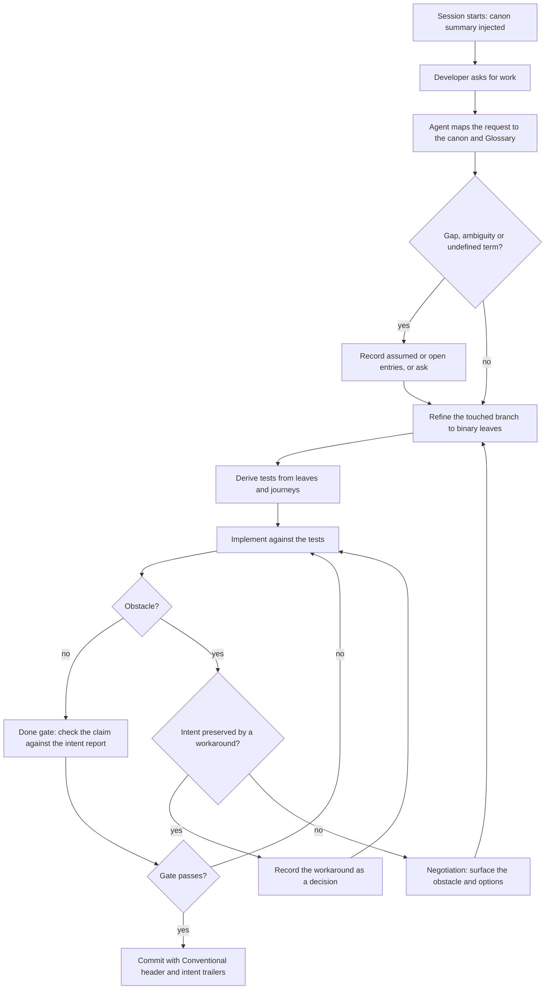

# A working session with HeadCanon

How a developer and the agent get from a request to a committed change
without intent drifting. Derived from the Workflow and Architecture sections
of the brief; the shape is the agent's reading and awaits confirmation.

| Step | State | Linked requirements |
| --- | --- | --- |
| S1 Session starts | assumed | REQ-11.1 |
| S2 Developer asks for work | assumed | REQ-1 |
| S3 Map request to canon and Glossary | assumed | REQ-5.1, REQ-5.2 |
| S4 Gap or ambiguity? | assumed | REQ-5.4, REQ-3.4 |
| S5 Record assumed or open entries, or ask | assumed | REQ-5.3, REQ-5.4, REQ-5.3.4 |
| S6 Refine to binary leaves | assumed | REQ-3.3, REQ-7.1 |
| S7 Derive tests | assumed | REQ-7.1, REQ-9.4 |
| S8 Implement | assumed | REQ-7.1 |
| S9 Obstacle? | assumed | REQ-7.2.1 |
| S10 Intent preserved? | assumed | REQ-7.4 |
| S11 Record workaround as a decision | assumed | REQ-7.3, REQ-8.2, REQ-1.3.1 |
| S12 Negotiation | assumed | REQ-7.2, REQ-7.5 |
| S13 Done gate | assumed | REQ-11.1, REQ-11.1.1 |
| S14 Gate passes? | assumed | REQ-11.1.1, REQ-11.1.2 |
| S15 Commit with trailers | assumed | REQ-8.3, REQ-8.5, REQ-8.5.1 |
