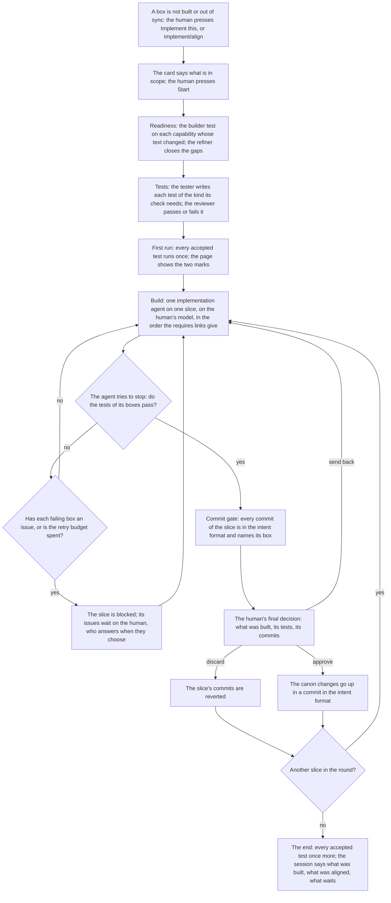

# Implement/align: one box or many, from readiness to the human's decision and the commit

How a box that is not built, or out of sync with the code, gets built and committed. The unit is one box: its card offers Implement this. Implement/align, at the top of the canvas, runs the same steps over the selected box and everything under it, or over everything when nothing is selected. Guessed and approved boxes are built alike; a red box, one with an issue, is left out and holds nothing else. Nobody waits for the human before the code: their time goes to what was built. Each step is a state the system is in, the action someone takes, and the outcome that moves it on. The shape is the session's reading of DEC-026 and awaits confirmation.

| Step | State | Linked requirements | Action | Outcome |
| --- | --- | --- | --- | --- |
| S1 Request | assumed | REQ-12.1.8, REQ-7.1 | the human presses Implement this on the card of a box that is not built or out of sync, or Implement/align at the top of the canvas with a box selected or none | a card opens with the scope: the boxes to test, to build, to align, and those left out for now since they need the human |
| S2 Start | assumed | REQ-7.1, REQ-8.5 | the human presses Start; with no session listening, the card shows the line to type in the terminal | the session makes the build branch, commits the canon there when it is not in git yet, and records the run with one slice per box to build or align |
| S3 Readiness | assumed | REQ-3.3, REQ-3.13 | for each capability in scope whose text changed since its last builder test, the tester writes each test case from the canon's text alone and lists what it had to assume; the refiner closes the gaps from the evidence | a costly gap the evidence does not settle is a draft with its question, red and left out; the rest are assumptions and block nothing |
| S4 Tests | assumed | REQ-9.4, REQ-9.5, REQ-9.6, REQ-4.1 | the tester writes the test of each box that carries a check, of the kind the check needs: unit, integration, end-to-end, eval; an end-to-end test is written from a journey recorded first; the reviewer passes or fails each against the rubric for its kind | the accepted tests are recorded with a description in plain words and committed; each shows on its box's card; nobody waited for the human |
| S5 First run | assumed | REQ-9.7, REQ-9.13 | every accepted test runs once, and the project's own tests are run as they pass today | the page shows which boxes are not built and which are out of sync; what passes now is the baseline of the round |
| S6 Build | assumed | REQ-7.1, REQ-3.15 | the session starts one implementation agent on one slice, on the model the human is using, with a brief made from the canon; one agent at a time, prerequisites first | the agent builds as it sees fit, may add guessed boxes marked as the builder's, and may file an issue that blocks its box |
| S7 Stop gate | assumed | REQ-11.1.1, REQ-7.2.2 | the agent tries to stop; the gate reads the result of the tests the agent owes, and whether a test that passed in the first run fails now | all pass and the tree is clean: on to the commit gate; otherwise the second question |
| S8 Blocked or held | assumed | REQ-11.1.2, REQ-7.5, REQ-5.4 | the gate asks whether each box still failing has an issue the agent filed, or whether a further attempt left the same tests failing with the retry budget spent | neither: the agent is sent back with the failing tests; the second: the gate files an issue of the kind impossible on each failing box and lets the agent go |
| S9 Issue answered | assumed | REQ-8.6, REQ-7.2.1 | the slice waits, blocked, with its issues under Issues and who asked; the round goes on with the other slices; the human answers when they choose | a fresh implementation agent starts on that box with the answer |
| S10 Commit gate | assumed | REQ-8.3, REQ-8.5 | the commit hook refuses any commit outside the intent format; when the agent returns, the session checks the slice again itself: the tests it owes, its commits naming its box, the tree left clean | the slice is put before the human |
| S11 Final decision | assumed | REQ-7.1, REQ-12.1.8 | the human reads what was built in plain words, the tests with their outcomes and the commits, on the box's card or the run's card, and approves, sends back with a note, or discards | approve and discard act at once; a note starts a fresh implementation agent on that box |
| S12 Discard | assumed | REQ-8.1, REQ-8.5 | the slice's commits are reverted, newest first, each revert in the intent format | the code is as it was before the slice; the box keeps its mark |
| S13 Approve | assumed | REQ-10.5, REQ-8.5.1 | the units the slice's commits changed are bound to the box as implementing it, its line saying not built is dropped, and the canon changes are committed in the intent format with the approver's name | the box says where it is built; the build branch holds the code, the tests and the canon together |
| S14 Next slice | assumed | REQ-3.15 | the session takes the next slice in the order the requires links give | the round continues, or ends when no slice is left |
| S15 The end | assumed | REQ-9.3, REQ-9.14, REQ-7.1 | the session runs every accepted test once more and the project's own tests | it says what was built, what was aligned, what waits on the human, every test that passed before and fails now, the commits with their intents and the model each agent ran on; the human merges the build branch |

Everything can stop and resume: the run, its slices and the results are stored beside the canon, and Stop on the card ends the round after the agent that is running.
