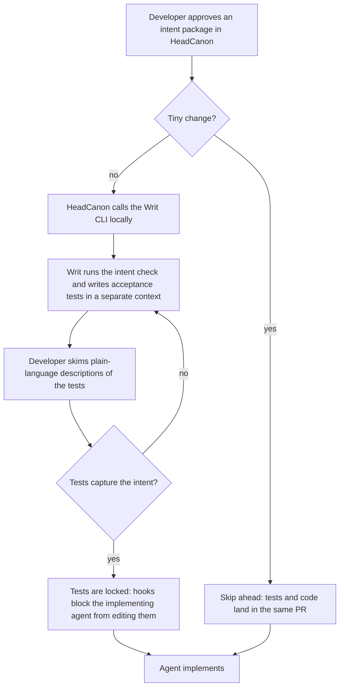

# Acceptance tests written ahead of implementation

HeadCanon calls Writ before implementing, so the acceptance tests come from
a different agent and exist before the code. The brief marks the whole flow
proposed.

| Step | State | Linked requirements |
| --- | --- | --- |
| S1 Approve an intent package | assumed | REQ-8.1, REQ-8.6 |
| S2 Tiny change? | assumed | REQ-9.4 |
| S3 HeadCanon calls Writ locally | assumed | REQ-9.4, REQ-10.3 |
| S4 Writ writes acceptance tests | assumed | REQ-9.2, REQ-9.5, REQ-9.10 |
| S5 Developer skims test descriptions | assumed | REQ-9.4 |
| S6 Tests capture the intent? | assumed | REQ-3.3, REQ-7.2.1 |
| S7 Skip for tiny changes | assumed | REQ-9.4 |
| S8 Tests are locked | assumed | REQ-9.6, REQ-9.7, REQ-11.2 |
| S9 Agent implements | assumed | REQ-7.1 |
