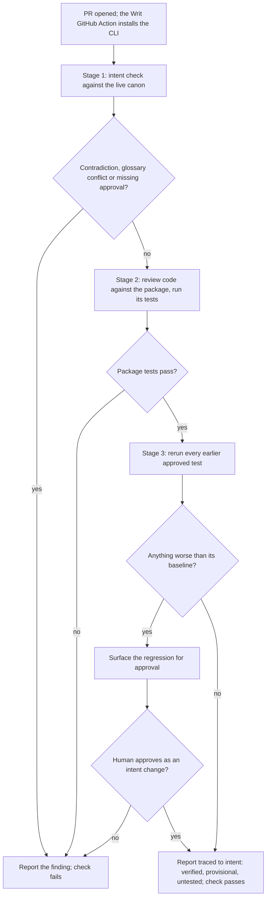

# Writ gates a pull request

What happens in CI when a PR opens. Three stages, intent before code, and
the report traced to intent is the output a reviewer reads.

| Step | State | Linked requirements |
| --- | --- | --- |
| S1 PR opened, Action installs CLI | assumed | REQ-10.1, REQ-10.2 |
| S2 Stage 1 intent check | assumed | REQ-9.2, REQ-10.5 |
| S3 Contradiction or missing approval? | assumed | REQ-8.7, REQ-9.16 |
| S4 Stage 2 delivery | assumed | REQ-9.2, REQ-10.3 |
| S5 Package tests pass? | assumed | REQ-9.1 |
| S6 Stage 3 preservation | assumed | REQ-9.3, REQ-10.6 |
| S7 Worse than baseline? | assumed | REQ-9.12, REQ-9.14 |
| S8 Surface regression | assumed | REQ-9.12 |
| S9 Approved as intent change? | assumed | REQ-9.14, REQ-8.1 |
| S10 Check fails | assumed | REQ-10.3 |
| S11 Report traced to intent | assumed | REQ-9.1, REQ-9.16 |
