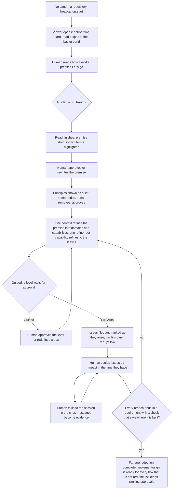

# Adopting an existing repository: fifteen minutes of the human's time in Full-Auto, an hour in Guided, however long the machine takes

How a person with an existing repository and no canon gets a canon drafted to its testable leaves, with every judgement that needs them ranked and waiting. Each step is a state the system is in, the action someone takes, and the outcome that moves it on. Human minutes are the active time the step asks of the person; the wall clock is the machine's and is not budgeted. The budget is fifteen minutes in Full-Auto and up to sixty in Guided, which asks for an approval at every level (DEC-025). The journey ends at one point in either mode: every branch ends in a requirement with a check that says where it is built; red boxes wait on the human and hold nothing else (DEC-026). Every step is meant to become a step of an end-to-end test.

| Step | State | Linked requirements | Action | Outcome | Human minutes |
| --- | --- | --- | --- | --- | --- |
| S1 Start | assumed | REQ-11.1, REQ-11.6 | the human runs `headcanon:start` in a repository with files and no canon | the adopt path is chosen; the viewer server starts; one browser tab opens | 0.5 |
| S2 Onboarding opens | assumed | REQ-11.6, REQ-12 | the system shows the onboarding card with a read progress bar at its top and starts reading the repository | the human knows what will happen and sees the read advancing | 0 |
| S3 Consent | assumed | REQ-11.6 | the human reads the card and presses Let's go | the system may spend their resources on the read and the premise | 1 |
| S4 Mode | assumed | REQ-11.6.3, REQ-3.4 | the human picks Guided (slower, cheaper, gated on approval) or Full-Auto (faster, costlier, reviewed later), and an optional cap; the setting carries into every later journey | the mode governs every later rung | 1 |
| S5 Premise draft | assumed | REQ-3.8, REQ-5.1, REQ-5.2 | the read ends; the system drafts the premise, checked by the quality rubric, glossary terms highlighted with their definitions on hover | the premise is on screen as editable text with an Approve button; nothing else runs | 0 |
| S6 Premise approved | assumed | REQ-3.8, REQ-5.3 | the human approves the premise as written or rewrites it in their words and approves | the premise is stated or resolved; the system may now spend on refinement | 3 |
| S7 Principles | assumed | REQ-3.7, REQ-5.3 | the system shows the principles as a numbered list; the human edits, adds with +, removes with −, approves | the principles are approved; refinement starts in the background | 3 |
| S8 Refinement | assumed | REQ-3.3, REQ-3.8, REQ-3.12, REQ-3.13, REQ-3.14, REQ-3.15 | one context, the agent `top`, refines the premise into domains and every domain into its capabilities, then drafts the product's journeys as guesses; one fresh refiner per capability refines it to the leaves, breadth first, each requirement saying where it is built; each capability is reviewed against the local rubric and put to the builder test, each domain checked against the global rubric | boxes land on the canvas as they pass; evidence is attached to each; the progress bar counts work left | 0 |
| S9 Gate | assumed | REQ-3.4, REQ-11.6.3 | in Guided mode the system stops at the end of a level | the level waits, blue, for the human | 0 |
| S10 Approve a level | assumed | REQ-3.4, REQ-5.3, REQ-8 | the human approves the level or redefines a box; the system continues one level down | the next level starts; a redefinition reruns the subtree with the previous version as evidence | Guided only: up to 45 across all levels |
| S11 Issues ranked | assumed | REQ-1, REQ-5.4, REQ-11.6.3 | contradictions, disambiguations, apocrypha and undefined issues are filed as they arise and ranked by impact; the bar shows blue, red and yellow | the human always sees the most impactful thing to settle next | 0 |
| S12 Settle by impact | assumed | REQ-1, REQ-5.3, REQ-5.4, REQ-8 | the human works the list top down: settles a contradiction, defines a term, rewrites a box, answers an undefined; each answer becomes direct evidence and the subtree redefines | the red count falls; blocked boxes unblock; the bar fills | 6 |
| S15 Chat | assumed | REQ-5.3, REQ-11.6, REQ-12 | the human writes to the session in the chat, with a highlighted passage from a card attached as context when they chose one; the session answers, and may withdraw an issue or change a box from what was said | the message is evidence of the direct kind; the canon or the list changes; the chat pings once, mutable with its bell | 3 |
| S13 Complete? | assumed | REQ-3.3, REQ-3.6 | the system checks whether every branch ends in a requirement with a check that says where it is built; red boxes wait on the human and do not hold the rest | yes moves on; no returns to refinement | 0 |
| S14 Adoption complete | assumed | REQ-11.6, REQ-12 | fanfare and confetti; the session says Implement/align is ready, and it works on every box that is not red (JRN-2); the issues panel keeps ranking approvals; the New feature button unlocks | regular operation begins; the human may approve more, or build, whenever they choose | 0.5 |

Human minutes in total: 15 in Full-Auto (5.5 before refinement starts, 9.5 on the list and the chat), up to 60 in Guided (the same plus the level approvals). Everything can stop and resume at any point: chat, canvas state and the list are saved.
