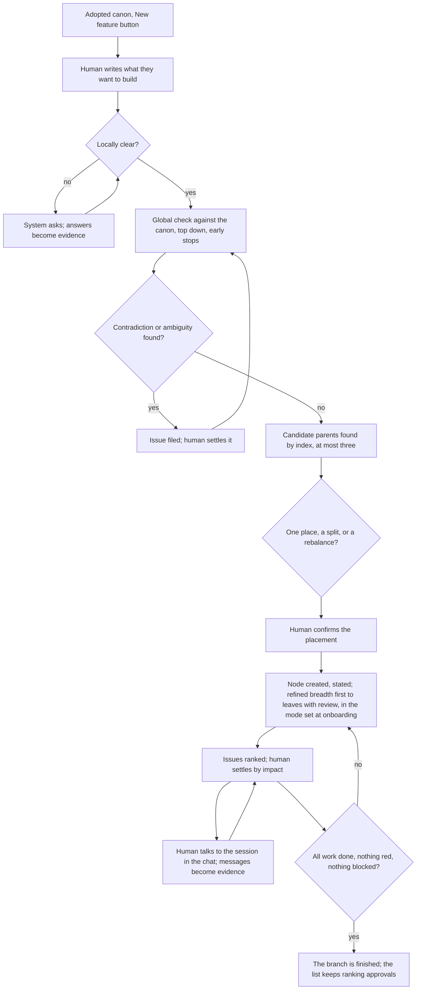

# Adding a feature after adoption: from a sentence to a finished branch in fifteen minutes of the human's time

How a person with an adopted canon gets a new intent into the tree, placed, refined to testable leaves and checked against everything already there. It is JRN-4 with a different starting point: the refinement, the review, the ranked list and the chat are the same, and the mode set at onboarding carries over. The journey ends when all work on the new branch is done, nothing red, nothing blocked; adoption's own end no longer waits for red boxes (DEC-026), and whether this one should is not decided. Each step is a state, an action and an outcome, with the human minutes it asks for; the budget is fifteen in Full-Auto. Every step is meant to become a step of an end-to-end test.

| Step | State | Linked requirements | Action | Outcome | Human minutes |
| --- | --- | --- | --- | --- | --- |
| S1 Entry | assumed | REQ-11.6, REQ-12 | the human presses New feature | a card asks "What do you want to build?" with a free text box | 0 |
| S2 Description | assumed | REQ-1, REQ-5.3 | the human writes what they want: a clean feature, an architectural change, or something unclear | the text is evidence of the direct kind | 3 |
| S3 Local check | assumed | REQ-5.4, REQ-3.11 | the system runs the clarity rubric over the description alone | pass moves on; fail asks | 0 |
| S4 Questions | assumed | REQ-5.4, REQ-5.3.4 | the system asks what the rubric could not settle; the human answers | each answer is evidence on the node to come | 2 |
| S5 Global check | assumed | REQ-1, REQ-8, REQ-3.12 | the description is checked against the canon top down with early stops: contradictions, ambiguity, duplicates | findings, or none | 0 |
| S6 Findings? | assumed | REQ-1, REQ-5.4 | a contradiction or an ambiguity with an existing box becomes an issue | the human sees it ranked at the top | 0 |
| S7 Settle | assumed | REQ-5.3, REQ-8 | the human settles the issue; the check reruns | the description is consistent with the canon, or the canon changed | 2 |
| S8 Candidates | assumed | REQ-3.14, REQ-5.2 | the system finds candidate parents by index: the capabilities sharing the description's terms, entities and files, ranked, at most three, with the overlap as the reason | the human sees where it could go | 0 |
| S9 Shape | assumed | REQ-3.12, REQ-3.14 | the system recommends one place, a split into two places, or a rebalance of the tree, by the one-concept test | a recommendation with its reason | 0 |
| S10 Placement | assumed | REQ-5.3, REQ-3.14 | the human confirms, picks another candidate, or chooses the split or the rebalance | the node is created where chosen, stated, in their words | 1 |
| S11 Refinement | assumed | REQ-3.3, REQ-3.13, REQ-3.15 | the node is refined breadth first to its leaves with the same cycle and review as adoption, in the mode set at onboarding; in Guided each level waits for approval as in JRN-4 | boxes land as they pass; evidence attached | 0 |
| S12 Settle by impact | assumed | REQ-1, REQ-5.4 | the human works the ranked issues of the new branch | red falls; the branch completes | 4 |
| S15 Chat | assumed | REQ-5.3, REQ-11.6, REQ-12 | the human writes to the session in the chat, a highlighted passage attached when they chose one; the session answers, and may withdraw an issue or change a box from what was said | the message is evidence of the direct kind; the canon or the list changes | 3 |
| S13 Complete? | assumed | REQ-3.3, REQ-3.6 | all work done: every new branch ends in a testable leaf, nothing red, nothing blocked | yes moves on | 0 |
| S14 Finished | assumed | REQ-11.6, REQ-12 | the branch is finished; the list keeps ranking approvals; tests and implementation are JRN-2, Implement/align, and the gate in CI is JRN-3 | the feature is specified and placed, ready for its tests | 0 |

Human minutes in total: 15 in Full-Auto, up to 60 in Guided as in JRN-4. Implement/align is JRN-2; Revise, Rebalance, update from a changed repository and starting from zero are later journeys.
