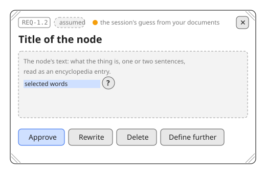

# The node card on the Adopt canvas

| Element | State | Linked requirements |
| --- | --- | --- |
| #head Reference tag, state badge and the colour's reason | assumed | REQ-12.1.8 |
| #title The node's title | assumed | REQ-12.1.8 |
| #body The node's text, with a ? on selected words | assumed | REQ-12.1.8, REQ-12.1.6 |
| #approve Approve button | assumed | REQ-11.6.1, REQ-12.1.8 |
| #rewrite Rewrite button | assumed | REQ-11.6.1, REQ-12.1.8 |
| #delete Delete button | assumed | REQ-11.6.3, REQ-12.1.8 |
| #define Define further button | assumed | REQ-3.13, REQ-12.1.7 |
| #grips Resize grips in the corners | assumed | REQ-12.1.8 |
| #close Close button | assumed | REQ-12.1.8 |

The first mock in this canon, drawn by the agent from the card the human described for the Adopt canvas. It exists to exercise the mock format on the project itself (REQ-11.5): one picture, one table, every button bound to the requirement that makes it do what it does.
