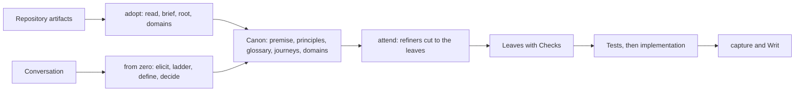
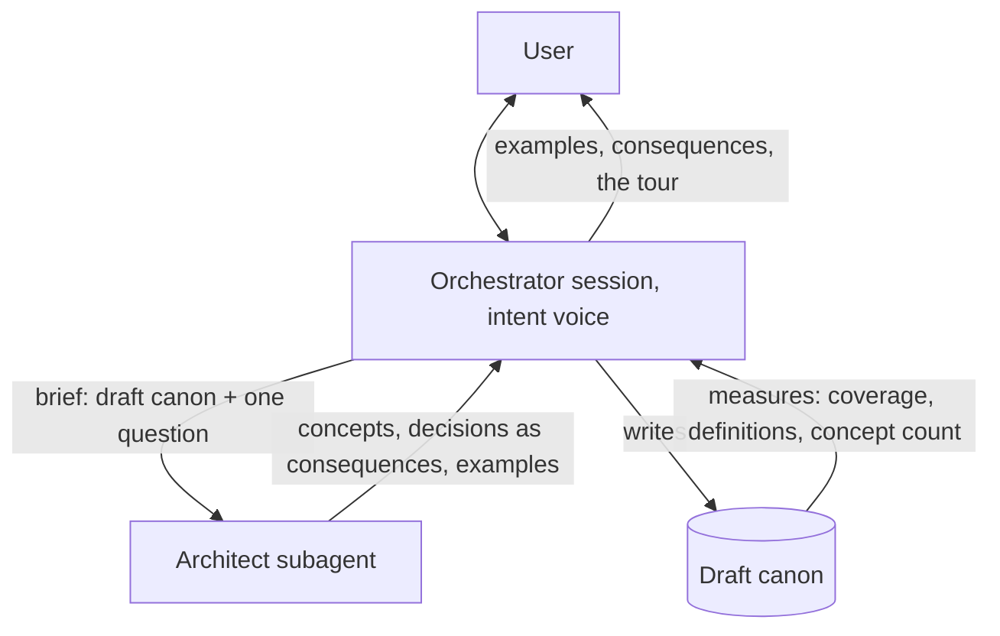
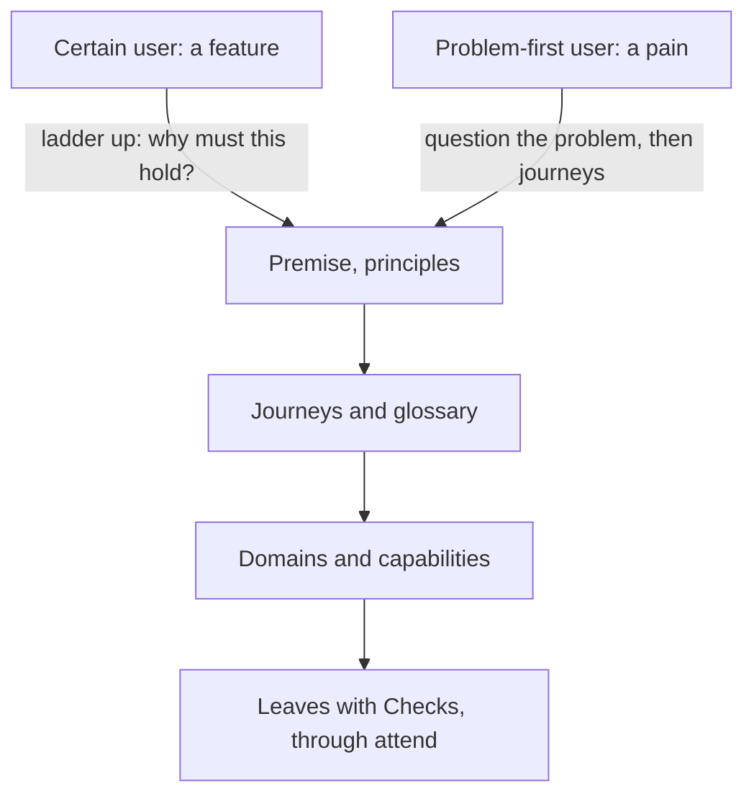

# Starting a canon from nothing: the flow for a non-coder

Design note, 2026-11-01. Registered from a conversation Althis had with a friend, so the idea is on record while the adoption flow is still being tested; nothing here is scheduled. Althis's brief first, then the thinking, then the open questions.

## The brief (Althis, 2026-11-01)

- Adopt depends on an ongoing project with artifacts. A flow that starts from zero is worth having: requirement elicitation, then tests, then implementation is the best way to build a project whoever builds it.
- The current system would not work from zero: with no artifacts it has nothing to guess a direction from.
- The from-zero user is a non-coder. Assume no understanding of coding practice and no capacity for architectural decisions; the agent carries those.
- Less visual than adoption: a chat agent, at most a feature visualization tool.
- People arrive with two kinds of idea. Some are certain of the direction, from doing their job on poor tools, and sometimes miss the forest for the trees. Some know they want to do something about a problem but not what; sometimes the right move is to ideate a solution, sometimes to question whether the problem is one.
- The core of the work is turning the user's stream of consciousness into something coherent and an architecture that suits it.
- Two forces to hold in balance: simplicity (fewer concepts and moving parts fail less) and completeness (enough concepts to model the problem without cutting essential parts). The model and the user find the middle together.
- The failure mode that matters most: lack of clear definitions. Undefined elements pass as complete because the interlocutor "gets it", which lets over-simplicity through. The pipeline must work extra hard against this.
- Proposed ensemble: an intent agent that dialogues with the user until intentions are clearly defined; an architecture agent that defines the few core concepts that run elegantly through the whole; an orchestrator that moderates between the two with the simplicity-completeness compromise in view. Between the intent agent and the orchestrator, an extreme focus on definitions.
- Skills on the intent side: concrete examples of architectural choices with benefits and drawbacks; visualization exercises such as asking the user to describe exactly the flow they envision.
- The user's intent is the starting point, never gospel: it is often not defined enough for implementation.
- The output: artifacts that flow into a semi-ready canon, or that found an adoption.

## What the canon already gives this flow

The target of the flow is not a new kind of document. It is the canon's upper layers, which already exist with a format, a check, a viewer and a continuation:

- The premise (what it is, for whom, Not this), the principles, the glossary, the journeys, then domains, capabilities and requirements down to leaves that carry a `kind` and a `## Check`.
- `source: "conversation, <date>"` is a defined source kind; the human's typed words are quoted under `## Stated`; the agent's reading is the Intent, `assumed` until approved.
- The jargon gate (`headcanon_ask` with `terms`): every undefined word in a draft is marked and the human keeps or drops it. This is the anti-"gets it" mechanism, already built.
- Laddering (DEC-015): a candidate is asked "why must this hold?" until the answer is a sentence the node above already says. Climbing a feature request to the premise is the same move.
- The attend loop and the refiners cut the layers below to the leaves without the human once the top is approved; the format file and the start sequence keep an old canon valid.

So the from-zero flow is a second front to the same pipeline. It replaces adopt's steps 1 to 4 (read the repository, brief, root, domains) and hands to attend; nothing after that changes. Its "artifacts" are the canon's upper layers themselves, plus the transcript as their source. Writing documents for adopt to read back would be a lossy detour through prose that the conversation already contains.

## Where users start, and where the flow brings them

- The certain user starts at features ("I want a button that…"). Each statement is laddered up: why must this hold? A rung that reaches a sentence of the premise is a capability or requirement under it. A rung that never reaches the premise means the premise is missing a domain, or the feature is out of scope and belongs under Not this. Forest and trees become explicit instead of argued.
- The problem-first user starts at the premise. The flow asks about the problem before any solution: for whom, how often, what happens when it is not solved, who solves it today and how. Then journeys: the day as it is, the day as they wish it. Capabilities are read off the journeys, never invented before them.
- Both converge on the same top: premise, principles, glossary, journeys. Then domains and capabilities. Then, through attend, leaves with Checks.

## The two forces, measured

A dialogue between two prompts about simplicity and completeness is vibes unless something measures. The draft canon can be measured, and the measures already half exist:

- Completeness: every journey step is bound to a capability (`step-unlinked`); every capability is reachable from some journey; every term used in an entry is defined; every capability has at least one leaf with a Check, or an issue saying why not.
- Simplicity: the concept count (terms, domains, capabilities); the cross-cutting ratio, terms used in two or more domains against terms used once; a term used once is a candidate to cut, a domain with one capability restates it (`single-child`), a capability no journey reaches is a candidate to drop.
- The judge is a procedure over the draft canon, as `HC next` is for order, not an argument between agents. The orchestrator reads the measures and picks the next move.

## Definitions as the gate

- No entry is accepted while it uses an undefined term. A definition is in the user's words, or chosen by the user from examples the agent offers.
- A definition is tested operationally, not by feel: the agent must be able to write a Check that uses it, an observable with a yes or no. A term that supports no Check is not defined yet.
- The tour: the agent narrates the user's flow back using only defined terms. Every place it has to hand-wave is a gap, and is said as one.
- Examples are the non-coder's language. Where a definition is missing, the agent shows two or three concrete scenarios and asks which is theirs; the definition is read off the choice. This is the ask card with options, which exists.

## The ensemble

- One session is both the orchestrator and the user's interlocutor. The intent voice is a skill of that session, not a second process: the user talks to the one that keeps the conversation, holds the draft canon and runs the measures. In Claude Code a subagent starts fresh on every call, so the interlocutor cannot be one.
- The architect is a subagent, briefed with the draft canon and one question, returning concepts (few, cross-cutting), decisions with their options stated as consequences the user can judge (cost, works offline, what is lost when a device dies, who can see what), and examples. It never addresses the user. Its decisions are DEC records, not requirements: the stack, the storage, where it runs.
- The user's statements are quoted under Stated. The laddered form is the Intent. A solution statement ("a dropdown") becomes a decision or a Deferred line under the requirement it serves ("the user picks one of several"). This is "not gospel" without disrespect, and it is the existing rule for a requested rewrite.
- A round: listen, ladder, define, propose (architect), pick (user, among consequences), write, measure, next move. The flow stops when the measures hold: premise and principles stated, journeys bound, every term defined, every capability with a leaf and a Check or an issue.
- The hand-off: a founding decision record like DEC-001 ("founded from conversation on <date>"), then attend cuts to the leaves, the Check sentences become the first tests, implementation follows with capture, and Writ gates it.

## Skills, consolidated with what exists

- Examples with consequences: `headcanon_ask` with options and descriptions, plus an archetype catalogue (REQ-3.8 already names `archetype` as a source: what every system of this kind needs). Open question below.
- Describe the flow: a journey record. The format exists and the viewer renders the step table and the graph. The Check sentences on the leaves are the user's acceptance stories, readable without code: "when I do X, Y happens".
- Question the problem: the premise prompts (for whom, how often, what if not, who solves it today).
- The tour: the definitions test above.

## Open questions for Althis

1. Scope of "from zero": an empty repository only, or also a repository with code and no documents? Adopt covers the second today.
2. Where does the flow end: at the canon with attend taking over as now, or does it also drive the first implementation (tests, then code)? The brief names the whole path.
3. Chat only, or chat with the canvas available for the user who wants to look? Journeys would be the "feature visualization".
4. The architect chooses technology within the principles, and the user judges only consequences. Is a choice the user never saw acceptable, recorded as an assumed decision for later review?
5. Which process talks to the user: the orchestrator with the intent voice as its skill (my recommendation), or an intent agent as the main session with the orchestrator and the architect behind it?
6. The time budget for a from-zero session, and whether it spans several sittings with the canon as the only memory.
7. Should the plugin ship a curated archetype catalogue (a shop, a tracker, a notes tool, a scheduler…) with their usual concepts and decisions, or should examples be generated per project?

## Diagrams

Two fronts, one pipeline:

The ensemble, one round:

Where users start, where the flow brings them:

