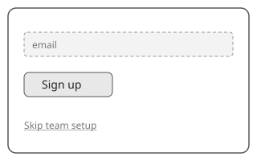

# Sign-up form

| Element | State | Linked requirements |
| --- | --- | --- |
| #email Email field | assumed | REQ-1.1 |
| #go Sign up button | stated | REQ-1.1, REQ-1 |
| #skip Skip team setup link | assumed | |
